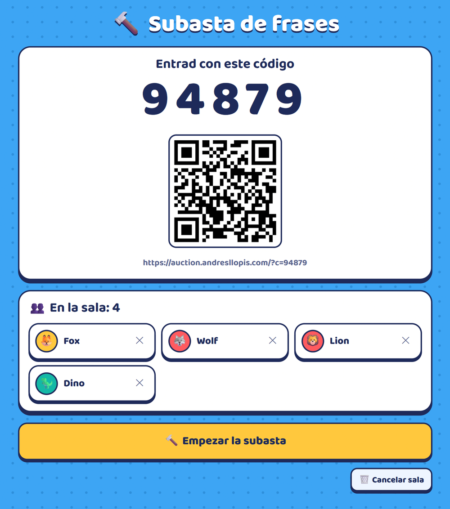
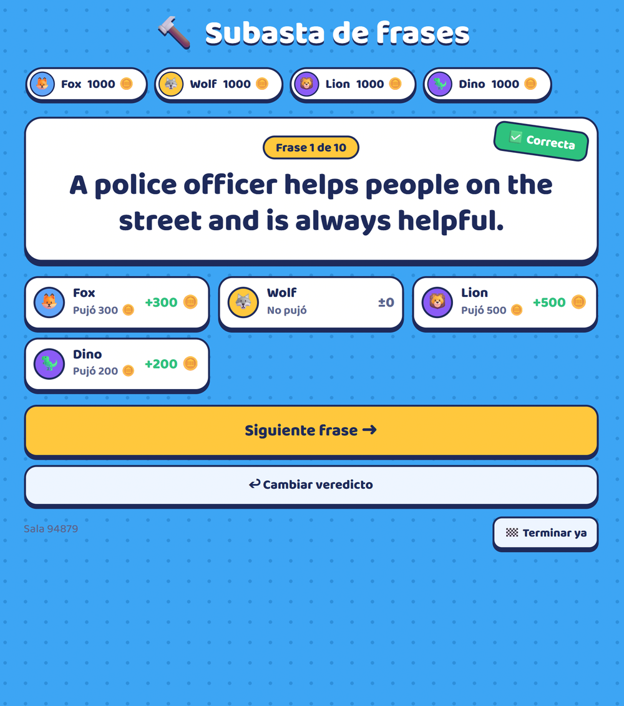
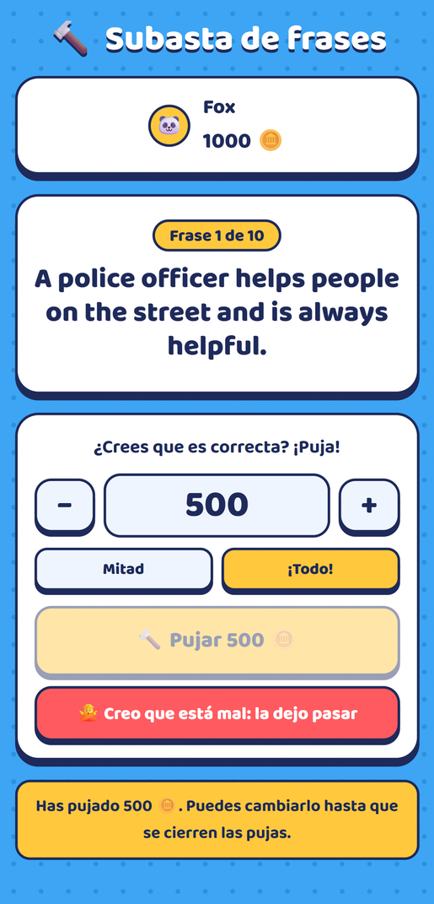
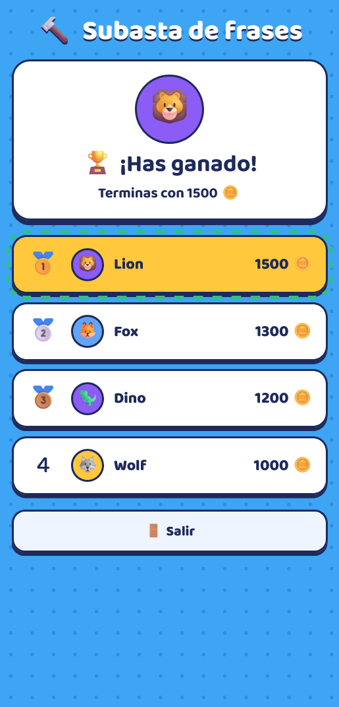

# 🔨 Subasta de frases

Juego en tiempo real para clases de inglés con alumnos hispanohablantes (**Spanish ESL learners**). Cada alumno, desde su móvil, apuesta monedas virtuales a que una frase en inglés es gramaticalmente correcta.

🇬🇧 [Read in English](README.md)

**▶️ Demo: [auction.andresllopis.com](https://auction.andresllopis.com)**

**Pantalla del profe (proyectada): código de sala y revelación**

<p align="center">
  
  
</p>

**Móvil del alumno: puja y podio final**

<p align="center">
  
  
</p>

## Cómo se juega

1. El profe abre `/?profe`, escribe una lista de frases (unas correctas y otras con errores) y elige el dinero inicial, la puja mínima y cuánto se recupera. La app crea una sala con un código de 5 cifras y un QR.
2. Los alumnos escanean el QR y entran con un apodo.
3. En cada frase, si creen que es correcta, **pujan** (en múltiplos de la puja mínima, o "¡todo!"). Si creen que está mal, **la dejan pasar**.
4. El profe cierra las pujas y revela la respuesta:
   - ✅ **Correcta:** las pujas se duplican.
   - ❌ **Incorrecta:** quien pujó pierde lo apostado. Si levanta la mano y explica el error, el profe puede devolverle una parte (un porcentaje o una cantidad fija).
5. Al final hay un podio (los empatados comparten puesto). Con **un solo jugador**, el objetivo es terminar con más dinero del que se empezó.

La estrategia es sencilla: pujar por las frases correctas y dejar pasar las incorrectas. Para eso, los alumnos tienen que detectar de verdad los errores.

## Probar la demo

Necesitas dos ventanas, una para el profe y otra para un alumno:

1. Abre **[auction.andresllopis.com/?profe](https://auction.andresllopis.com/?profe)** y pulsa **🔨 Crear sala**.
2. Abre [auction.andresllopis.com](https://auction.andresllopis.com) en una **ventana de incógnito** o en el móvil, y escribe el código de la sala y un apodo.
3. Juega unas cuantas frases. Al terminar, pulsa **🧹 Borrar la partida**.

Los datos de la demo se borran periódicamente.

## Tecnologías

- **HTML, CSS y JavaScript sin frameworks** (módulos ES), todo en un único `index.html` y sin paso de compilación.
- **Firebase Realtime Database** mantiene todos los dispositivos sincronizados en tiempo real.
- **Firebase Authentication anónima**, para que los alumnos no necesiten cuenta.
- **[qrcode-generator](https://github.com/kazuhikoarase/qrcode-generator)**, cargado desde cdnjs con un hash de integridad (SRI).
- Fuente **[Baloo 2](https://github.com/EkType/Baloo2)**, alojada junto a la app (licencia SIL Open Font License).
- Alojado en **Netlify**.
- Funciona en el móvil, tiene modo claro y oscuro, y respeta `prefers-reduced-motion`.

### Flujo de la partida y modelo de datos

Cada sala es una pequeña máquina de estados que controla el profe:

```
lobby → bidding ⇄ closed → reveal → bidding (siguiente frase) … → end
```

```
games/{código}
├── host, createdAt
├── config        { start, minBid, recMode, recVal }
├── phrases       [ "…", "…" ]
├── state         { phase, idx, total, phrase, verdict }
├── players/{uid} { name, money, emoji, color, joinedAt }
├── bids/{idx}/{uid}: cantidad
└── results/{idx}/{uid} { bid, delta, explained }
```

## Privacidad

La app está pensada para clases con niños, así que está diseñada para recoger los mínimos datos posibles:

- **Sin cuentas.** No hay correo ni contraseña: cada dispositivo inicia sesión de forma anónima con un identificador aleatorio.
- **Apodos, no nombres.** Lo único que escribe el alumno es un apodo de hasta 20 caracteres, y la app le pide que no use su nombre completo.
- **Sin seguimiento.** No hay analítica, ni publicidad, ni cookies de seguimiento. La página no carga nada de Google salvo el propio Firebase (incluso la fuente está alojada junto a la app).
- **Las partidas no se quedan para siempre.** Una partida se borra cuando el profe pulsa "Borrar la partida", o automáticamente cuando ese mismo profe crea otra sala y la anterior tiene más de 24 horas.
- **Salir limpia el dispositivo.** El botón "Salir" hace que el dispositivo olvide la sala y su sesión anónima.

Para ser del todo transparentes: Firebase guarda una ficha por cada usuario anónimo (un identificador aleatorio y sus fechas de acceso, sin datos personales), y esas fichas no se borran solas. Como en cualquier web, los proveedores de alojamiento (Netlify y Google/Firebase) tratan la dirección IP de quien la visita. Este proyecto busca minimizar los datos; no es una evaluación de cumplimiento legal.

## Seguridad

Toda la lógica del juego se ejecuta en el navegador, así que el servidor no puede fiarse del cliente. Las reglas de [`database.rules.json`](database.rules.json) aplican las normas del juego en el servidor:

- **Solo el profe que creó la sala** puede cambiar el estado de la partida, marcar los veredictos o cambiar el dinero de nadie.
- **Cada alumno solo puede crear su propio jugador**, una vez y con el dinero inicial. Solo puede borrarse a sí mismo mientras la sala está en la sala de espera, así que no puede volver a entrar para recuperar el dinero inicial.
- **El servidor valida las pujas.** Un alumno solo puede pujar en la fase de pujas y solo por la frase actual. La cantidad no puede superar su dinero, tiene que ser al menos la puja mínima y debe ser múltiplo de ella, salvo que apueste todo lo que tiene.
- **Protección contra XSS.** Los campos de cada jugador se validan (longitud del nombre, color `#RRGGBB`, emoji corto, sin campos extra) y se escapan antes de mostrarlos.
- **No se pueden listar las salas.** Un profe solo puede buscar las suyas. La app lo usa para borrar las salas con más de 24 horas.
- La configuración web de Firebase no es secreta (cualquiera la ve en la página publicada). Aun así, no está en el repositorio (`firebase-config.js` está en `.gitignore`), y la clave de API solo funciona desde los dominios de la app.

Las reglas se probaron con el simulador de reglas de Firebase y en partidas reales.

## Instalar tu propia copia

1. Crea un proyecto en la [consola de Firebase](https://console.firebase.google.com/). El plan gratuito Spark es suficiente.
2. Ve a **Authentication → Método de acceso** y activa **Anónimo**. Añade tu dominio en **Dominios autorizados**.
3. Ve a **Realtime Database**, crea una base de datos, pega [`database.rules.json`](database.rules.json) en la pestaña **Reglas** y pulsa **Publicar**.
4. Ve a **Configuración del proyecto → Tus apps**, añade una app web y copia su configuración.
5. Copia `firebase-config.example.js` como `firebase-config.js` y rellena tus datos.
6. Sirve la carpeta por HTTP. Los módulos ES no se cargan desde `file://`, así que abrir el archivo con doble clic no funcionará. Por ejemplo:
   ```bash
   npx serve .
   ```
   También puedes arrastrar la carpeta a [Netlify Drop](https://app.netlify.com/drop).
7. Si quieres, restringe la clave de API a tus dominios en Google Cloud Console (**APIs y servicios → Credenciales**).

## Estructura del proyecto

```
├── index.html                  # toda la app (interfaz + lógica del juego)
├── database.rules.json         # reglas de seguridad de Firebase
├── firebase-config.example.js  # plantilla de configuración (cópiala como firebase-config.js)
├── fonts/                      # archivos de la fuente Baloo 2 + su licencia (OFL.txt)
├── docs/screenshots/           # imágenes de este README
└── LICENSE
```

## Licencia

[MIT](LICENSE) © 2026 Andrés Llopis
