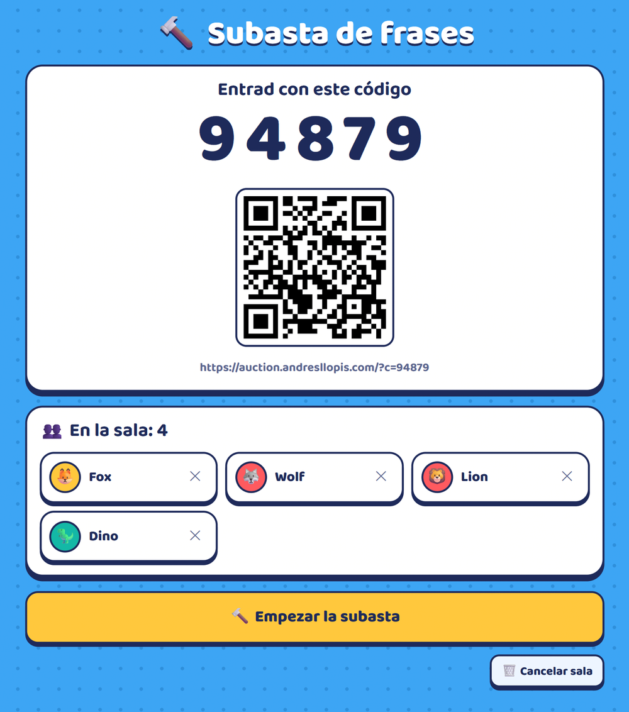
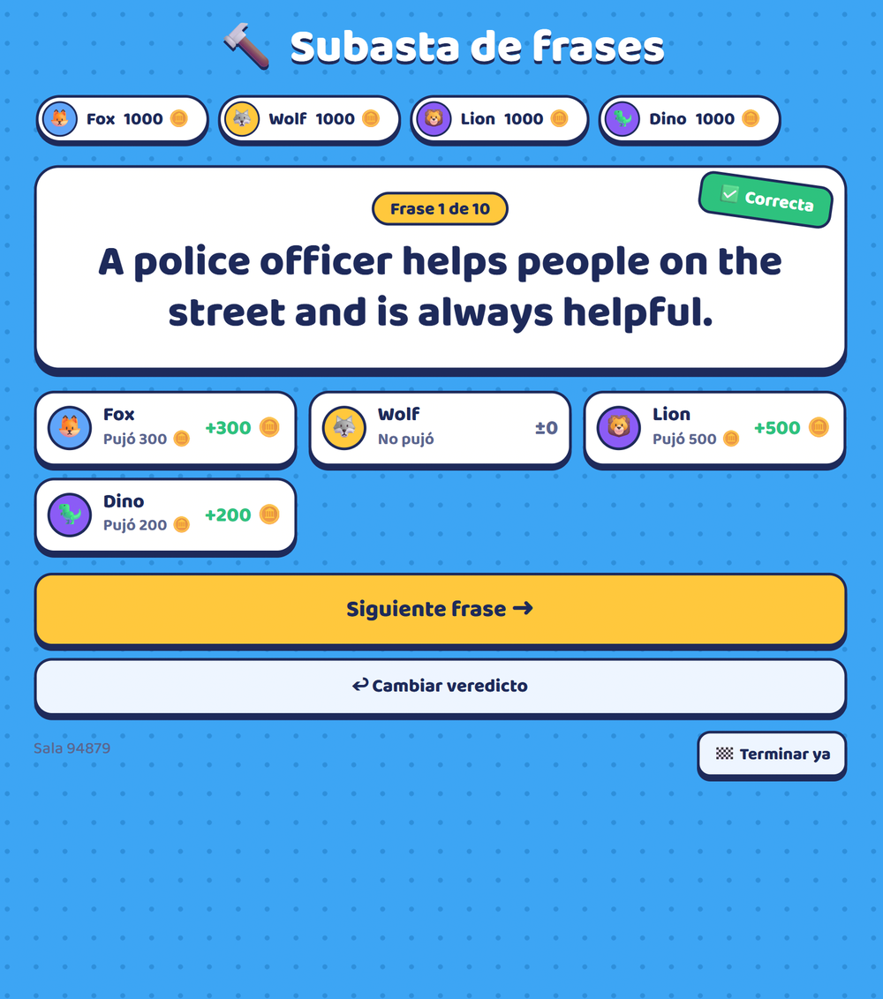
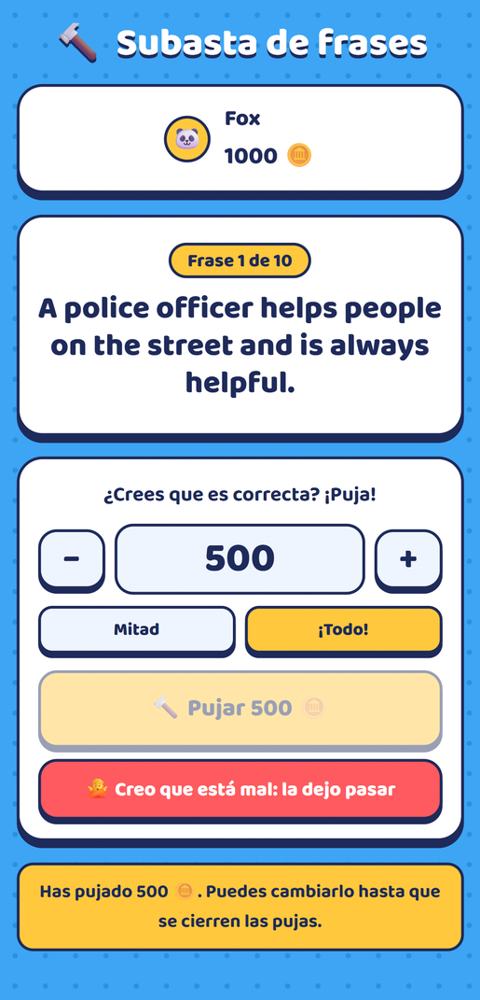
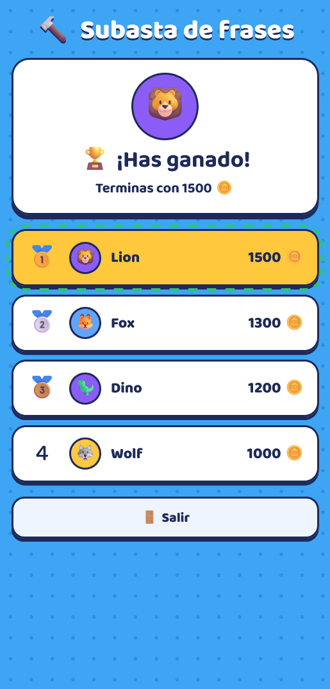

# 🔨 Phrase Auction (Subasta de frases)

A real-time classroom game for **Spanish ESL (English as a Second Language) learners**. Students bet virtual coins on whether English sentences are grammatically correct, each from their own phone.

🇪🇸 [Leer en español](README.es.md)

**▶️ Live demo: [auction.andresllopis.com](https://auction.andresllopis.com)** (the interface is in Spanish)

**Teacher's screen (projected): room code and verdict reveal**

<p align="center">
  
  
</p>

**Student's phone: bidding and final podium**

<p align="center">
  
  
</p>

## How it works

1. The teacher opens `/?profe`, writes a list of sentences (some correct, some with mistakes) and chooses the starting money, the minimum bid and how much students can recover. The app creates a room with a 5-digit code and a QR code.
2. Students scan the QR code and join with a nickname.
3. For each sentence, students either **bid** (in multiples of the minimum bid, or "all in") if they think it is correct, or **let it pass** if they think it is wrong.
4. The teacher closes the bids and reveals the answer:
   - ✅ **Correct:** every bid is doubled.
   - ❌ **Incorrect:** bidders lose their bid. If they raise their hand and explain the mistake, the teacher can give back part of it (a percentage or a fixed amount).
5. At the end there is a podium (tied players share a place). With a **single player**, the goal is to finish with more money than at the start.

The strategy is simple: bid on the correct sentences and let the wrong ones go. To do that, students have to actually spot the mistakes.

## Try the demo

You need two windows, one for the teacher and one for a student:

1. Open **[auction.andresllopis.com/?profe](https://auction.andresllopis.com/?profe)** and click **🔨 Crear sala** (Create room).
2. Open [auction.andresllopis.com](https://auction.andresllopis.com) in a **private/incognito window** or on your phone, then enter the room code and a nickname.
3. Play a few sentences. When you finish, click **🧹 Borrar la partida** (Delete game).

Demo data is deleted periodically.

## Tech stack

- **Vanilla HTML, CSS and JavaScript** (ES modules) in a single `index.html`, with no frameworks and no build step.
- **Firebase Realtime Database** keeps every device in sync in real time.
- **Firebase Anonymous Authentication**, so students do not need an account.
- **[qrcode-generator](https://github.com/kazuhikoarase/qrcode-generator)**, loaded from cdnjs with a Subresource Integrity hash.
- **[Baloo 2](https://github.com/EkType/Baloo2)** font, hosted with the app (SIL Open Font License).
- Hosted on **Netlify**.
- Works on phones, supports light and dark mode, and respects `prefers-reduced-motion`.

### Game flow and data model

Each room is a small state machine controlled by the teacher:

```
lobby → bidding ⇄ closed → reveal → bidding (next sentence) … → end
```

```
games/{code}
├── host, createdAt
├── config        { start, minBid, recMode, recVal }
├── phrases       [ "…", "…" ]
├── state         { phase, idx, total, phrase, verdict }
├── players/{uid} { name, money, emoji, color, joinedAt }
├── bids/{idx}/{uid}: amount
└── results/{idx}/{uid} { bid, delta, explained }
```

## Privacy

The app is meant for classes with children, so it is designed to collect as little data as possible:

- **No accounts.** There is no email and no password: each device signs in anonymously with a random ID.
- **Nicknames, not names.** The only thing a student types is a nickname of up to 20 characters, and the app asks them not to use their full name.
- **No tracking.** There is no analytics, no advertising and no tracking cookies. The page does not load anything from Google except Firebase itself (even the font is hosted with the app).
- **Games don't stay forever.** A game is deleted when the teacher clicks "Delete game", or automatically when the same teacher creates a new room and the old one is more than 24 hours old.
- **Leaving clears the device.** The "Exit" button makes the device forget the room and its anonymous session.

To be completely transparent: Firebase keeps a record for each anonymous user (a random ID and its sign-in dates, with no personal data), and those records are not deleted automatically. As with any website, the hosting providers (Netlify and Google/Firebase) process visitors' IP addresses. This project aims to minimise data; it is not a legal compliance assessment.

## Security

All the game logic runs in the browser, so the server cannot trust the client. The rules in [`database.rules.json`](database.rules.json) enforce the game rules on the server:

- **Only the teacher who created the room** can change the game state, set the verdicts or change anyone's money.
- **A student can only create their own player**, once, with the starting money. They can only remove themselves while the room is in the lobby, so they cannot rejoin to reset their money.
- **Bids are validated by the server.** A student can only bid during the bidding phase and only on the current sentence. The amount cannot be more than their money, must be at least the minimum bid and must be a multiple of it, unless they bid everything they have.
- **No stored XSS.** Player fields are validated (name length, `#RRGGBB` colours, short emoji, no extra fields) and escaped before they are shown.
- **Rooms cannot be listed.** A teacher can only search for their own rooms. The app uses this to delete rooms older than 24 hours.
- The Firebase web config is not a secret (anyone can see it in the deployed page). Even so, it is kept out of the repository (`firebase-config.js` is in `.gitignore`), and the API key only works from the app's own domains.

The rules were tested with the Firebase Rules Playground and in real games.

## Run your own copy

1. Create a project in the [Firebase console](https://console.firebase.google.com/). The free Spark plan is enough.
2. Go to **Authentication → Sign-in method** and enable **Anonymous**. Add your domain under **Authorized domains**.
3. Go to **Realtime Database**, create a database, paste [`database.rules.json`](database.rules.json) into the **Rules** tab and click **Publish**.
4. Go to **Project settings → Your apps**, add a web app and copy its config.
5. Copy `firebase-config.example.js` to `firebase-config.js` and fill in your values.
6. Serve the folder over HTTP. ES modules do not load from `file://`, so opening the file directly will not work. For example:
   ```bash
   npx serve .
   ```
   You can also drag the folder onto [Netlify Drop](https://app.netlify.com/drop).
7. Optionally, restrict the API key to your domains in Google Cloud Console (**APIs & Services → Credentials**).

## Project structure

```
├── index.html                  # the whole app (UI + game logic)
├── database.rules.json         # Firebase security rules
├── firebase-config.example.js  # config template (copy it to firebase-config.js)
├── fonts/                      # Baloo 2 font files + their license (OFL.txt)
├── docs/screenshots/           # images used in this README
└── LICENSE
```

## License

[MIT](LICENSE) © 2026 Andrés Llopis
